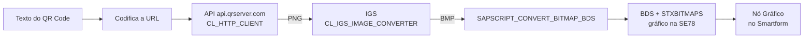

# SAP QR Code BMAP: QR Code em Smartforms sem suporte nativo

Gera um **QR Code como gráfico bitmap (BMAP) na SE78** a partir de qualquer texto (URL, código, identificador etc.), para ser exibido em **Smartforms** ou **SAPscript**.

É uma solução para ambientes SAP antigos que **não têm QR Code nativo** (sem o tipo de código de barras QR na SE73/SMARTSTYLES e sem Adobe Forms).

---

## Como funciona



1. **Download**: a função monta a URL da API pública `api.qrserver.com` com o conteúdo e baixa o QR Code em **PNG** via `CL_HTTP_CLIENT`.
2. **Conversão**: o **IGS** (Internet Graphics Service) converte o PNG em **BMP** e redimensiona a imagem para o tamanho pedido.
3. **Importação na SE78**: o BMP é convertido para o formato interno do SAPscript (`SAPSCRIPT_CONVERT_BITMAP_BDS`) e gravado no **BDS** e na tabela **STXBITMAPS**. É o mesmo processo que a SE78 faz quando você importa um gráfico manualmente.
4. **Exibição**: o Smartform mostra o gráfico em um nó **Gráfico** pelo nome gerado.

---

## Estrutura do repositório

```
sap-qrcode-bmap/
├── README.md
├── src/
│   ├── LZQRCODETOP.abap          # Declarações globais do grupo de funções
│   ├── Z_GERA_QRCODE_BMAP.abap   # Módulo de função (ponto de entrada)
│   └── LZQRCODEF01.abap          # Subrotinas (download, conversão, gravação BDS)
└── exemplos/
    └── exemplo_smartforms.abap   # Chamada dentro do Smartform
```

---

## Pré-requisitos

Há quatro coisas para verificar no ambiente antes de instalar:

| Item | Para quê | Como verificar |
|---|---|---|
| **IGS ativo** | Converter PNG em BMP | Transação `SIGS` ou programa `GRAPHICS_IGS_ADMIN`; destino RFC `IGS_RFC_DEST` na `SM59` |
| **Acesso HTTP de saída** | Chamar a API de QR Code | `SMICM` (serviço HTTP ativo) e proxy em `SICF` > *Client* > *Proxy Settings*, se a rede exigir |
| **Liberação de firewall** | Servidor SAP alcançar `api.qrserver.com` | Testar com um programa simples ou pela `SM59` (destino tipo G) |
| **Autorização SE78** | Gravar gráficos (BDS/STXBITMAPS) | O usuário que executa precisa poder criar gráficos |

> Se o ambiente exigir HTTPS, troque `http://` por `https://` em `f_download_qrcode` e importe o certificado do site na `STRUST` (SSL Client Anonymous).

---

## Instalação

1. Na **SE80/SE37**, crie o grupo de funções `ZQRCODE`.
2. Cole o conteúdo de `src/LZQRCODETOP.abap` no include TOP.
3. Crie o include `LZQRCODEF01` e cole o conteúdo de `src/LZQRCODEF01.abap`.
4. Crie o módulo de função `Z_GERA_QRCODE_BMAP` com a interface abaixo e cole o código de `src/Z_GERA_QRCODE_BMAP.abap`.
5. Ative tudo.

> Ajuste os nomes (`ZQRCODE`, `Z_GERA_QRCODE_BMAP`) ao padrão de nomenclatura da sua empresa.

### Interface da função

| Parâmetro | Tipo | Descrição |
|---|---|---|
| `IV_CONTEUDO` | `STRING` | Texto que vai virar QR Code (sem codificar, a função codifica) |
| `IV_BMAP_NAME` | `TDOBNAME` | Nome do gráfico que será criado/atualizado na SE78 |
| `IV_TAMANHO` | `I` (opcional, padrão `100`) | Largura/altura final em pixels |

| Exceção | Quando ocorre |
|---|---|
| `HTTP_ERROR` | Falha ao criar o cliente HTTP, enviar/receber ou status diferente de 200 |
| `IGS_ERROR` | IGS indisponível ou erro na conversão PNG → BMP |
| `CONVERSION_FAILED` | Erro em `SAPSCRIPT_CONVERT_BITMAP_BDS` |
| `ENQUEUE_FAILED` | Gráfico bloqueado por outro processo |

---

## Uso no Smartform

**1. Variável global** (aba *Definições globais*):

```
W_QRCODE  TYPE TDOBNAME
```

**2. Nó *Código de programa*** antes do gráfico, chamando a função:

```abap
CONCATENATE 'ZQRCODE' is_dados-id_registro
       INTO lv_bmap_name SEPARATED BY '_'.

lv_conteudo = is_dados-qr_conteudo.

CALL FUNCTION 'Z_GERA_QRCODE_BMAP'
  EXPORTING
    iv_conteudo       = lv_conteudo
    iv_bmap_name      = lv_bmap_name
    iv_tamanho        = 100
  EXCEPTIONS
    http_error        = 1
    igs_error         = 2
    conversion_failed = 3
    enqueue_failed    = 4
    OTHERS            = 5.

IF sy-subrc = 0.
  w_qrcode = lv_bmap_name.
ENDIF.
```

**3. Nó *Gráfico***:

| Campo | Valor |
|---|---|
| Nome | `&W_QRCODE&` |
| Objeto | `GRAPHICS` |
| ID | `BMAP` |
| Tipo | Colorido (`BCOL`) |

O exemplo completo está em [`exemplos/exemplo_smartforms.abap`](exemplos/exemplo_smartforms.abap).

---

## Pontos de atenção

- **Sempre trate as exceções** no `CALL FUNCTION`. Sem a cláusula `EXCEPTIONS`, uma falha de rede ou de IGS gera dump na impressão.
- **Nome único por impressão**: use um identificador do registro no nome do gráfico (ex.: `ZQRCODE_000123`), senão duas impressões simultâneas podem trocar o QR Code entre si.
- **Acúmulo de gráficos na SE78**: cada nome novo cria um gráfico. Em produção, programe um job de limpeza (por exemplo, apagar `GRAPHICS/BMAP` com prefixo `ZQR*` mais antigos que X dias) ou reutilize nomes fixos quando não houver concorrência.
- **Dados enviados a terceiros**: o conteúdo do QR Code vai na URL para um serviço externo. Avalie com a área de segurança/LGPD se isso é aceitável para o tipo de dado (dados pessoais ou de pagamento, por exemplo).
- **Dependência externa**: se a API ficar fora do ar, o QR Code não é gerado. Para quem quiser eliminar a dependência, a alternativa é hospedar um gerador próprio na rede interna e trocar só a URL em `f_download_qrcode`.
- **Sintaxe clássica**: o código não usa declarações inline nem `abap_bool`, para rodar em releases antigos.

---

## Melhorias em relação à versão original

Esta versão traz:

- **Correção de bug**: `set_image` recebia `blob_size` de uma variável que nunca era preenchida (sempre zero). Agora recebe o tamanho real do PNG.
- **Codificação de URL dentro da função**: antes, quem chamava tinha que trocar `&` por `%26`. Agora a função codifica `%`, `&`, `#`, `+` e espaço. **Não codifique o conteúdo antes de chamar**, senão ele fica codificado duas vezes.
- **Tratamento de erros**: as falhas de HTTP e IGS, que antes eram ignoradas em silêncio, agora disparam exceções. A função também verifica o status HTTP da resposta.
- **Atualização em vez de duplicação**: a função busca o `DOCID` existente na STXBITMAPS. Antes, toda execução criava um novo documento no BDS, mesmo para um nome já existente, e deixava documentos órfãos.
- **Tamanho configurável** com o parâmetro `IV_TAMANHO`.
- Remoção de variáveis globais que não eram usadas e tipagem dos parâmetros dos FORMs.

---

## Créditos

A lógica de importação no BDS/STXBITMAPS segue o processo standard de upload de gráficos da SE78. QR Codes gerados pela API pública [goQR.me / api.qrserver.com](https://goqr.me/api/).
